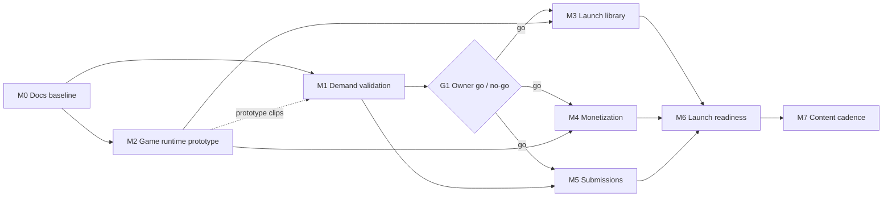

# ItsThatGame Roadmap

**Status:** Canonical. This document is the single source of truth for scope, priorities,
dependencies, delivery sequencing, and completion criteria. Detailed requirements and
designs live in the linked documents; this file references their IDs instead of
restating them.

**Last reconciled:** 2026-10-04 (initial baseline, see [§2 Audit](#2-audit-of-existing-material)).

---

## 0. How to read this document

### Provenance tags

Every material statement in the document set carries one of these tags when its origin
is not obvious:

| Tag | Meaning |
|---|---|
| `[User]` | Stated or clearly originated by the project owner (Ender). |
| `[Delegated]` | Decided by an agent under the owner's delegation on 2026-10-04. Not owner-approved; may be revisited freely by the owner. |
| `[Assumption]` | Believed true, not verified. Must be checked before it is relied on for something irreversible. |
| `[Proposal]` | A suggested target or option, e.g. a number. Not a commitment. |
| `[Open]` | Unresolved question. Listed in [§6](#6-open-questions-and-conflicts). |

### Status values

`Done` (merged and verified, with evidence) · `Partial` · `Planned` · `Blocked`
(names the blocker) · `Deferred` (out of current scope, with reason).

---

## 1. Product summary

**Purpose.** ItsThatGame is an ad-free collection of original hypercasual mobile games,
built around the games people see in mobile ads ("we built the game from the ad"), with a
way for players to submit ad games they want made. `[User]` (pitch, as reflected in the
analysis the owner shared on 2026-10-04; working tagline "The last mobile ad game you'll
ever need").

**Intended users.** Ad-weary casual players; parents who want ad-free games for their
children (positioning only, see `[Open]` Q3); people who play offline (flights, travel,
deployments, poor signal). Detail: [PRD §2](requirements/PRD.md#2-users-and-personas).

**Desired outcomes.** Prove that enough people will pay for ad-free hypercasual games
(`BO-1`), then build a library and release cadence that sustains paid retention (`BO-2`,
`BO-3`) at an acquisition cost below customer value (`BO-4`). Detail:
[BRD §3](requirements/BRD.md#3-business-outcomes).

**In scope (MVP).** Demand-validation landing page and waitlist; iOS and Android app with
a library of bundled, offline-playable original games; a free tier with no ads; a paid
unlock of the full library; restore purchases; in-app submission of game ideas with
internal moderation; privacy-preserving aggregate analytics; the minimal backend these
need. Capabilities: [PRD §4](requirements/PRD.md#4-product-capabilities).

**Explicit non-goals (MVP).** Any advertising or ad-supported tier; third-party ad,
attribution, or tracking SDKs; user accounts and cloud save; multiplayer and
leaderboards; public submission voting; user-uploaded media; remotely downloaded game
code; web or desktop app for players; Kids Category listing. See
[PRD §5](requirements/PRD.md#5-non-goals-and-deferred-capabilities).

---

## 2. Audit of existing material

Performed 2026-10-04 against `github.com/Digifender-LLC/itsthatgame`.

| Finding | Evidence |
|---|---|
| The repository had **no commits and no branches**. No source code, tests, configuration, CI, agent instructions, or documentation existed. | `git ls-remote origin` returned no refs; GitHub branch listing returned an empty list. |
| There was **no roadmap at all**, fragmented or otherwise. This document is derived from scratch. | As above. |
| The only planning input is the owner's message in the project thread on 2026-10-04: an analysis of the pitch (ad-free hypercasual collection, "fake ad" hook, submission feature, $5/month idea, pricing and retention risks, parent and offline angles, advice to validate demand first) plus instructions to create `agents.md` and this document set. | Project thread (not in the repo). Its content is captured as `[User]` pitch items and `[Proposal]` analysis items in the [BRD](requirements/BRD.md). |
| The analysis is advice, not an owner decision. Its pricing ($1.99–2.99/month, $15–20 lifetime), free tier, and validate-first suggestions are treated as `[Proposal]` until the owner confirms. The validate-first sequencing is adopted as a `[Delegated]` planning decision because it is the conservative choice. | — |
| No external systems (stores, Cloudflare, RevenueCat, domains, social accounts) were inspected. Nothing about their state is assumed beyond what is labeled `[Assumption]`. | — |

**Current state:** documentation only (this PR). **Target state:** a released iOS/Android
app with a free tier and paid full-library unlock, a regular cadence of new original
games, a working submission channel, and a low-cost backend, preceded by evidence of paid
demand.

Files present after this task: `agents.md`, `CLAUDE.md`, `README.md`, `docs/**`,
`scripts/check_docs.py`.

---

## 3. Constraints, assumptions, and material decisions

### Confirmed constraints

- `BC-1` No advertising in the product, in any tier. `[User]` (the product premise)
- `BC-4` Game mechanics may be inspired by ads; art, names, characters, audio, and
  overall look must be original. `[User]` (from the shared analysis; adopted as a hard
  constraint because the alternative is legal exposure)
- This task is documentation only; no features or infrastructure. `[User]`

All business constraints: [BRD §5](requirements/BRD.md#5-business-constraints).

### Key assumptions

- `[Assumption]` One owner-developer, using AI coding agents, builds and operates the
  product. Drives the "lowest operational burden" bias in every design choice.
- `[Assumption]` Digital unlocks sold inside the iOS and Android apps use the platform's
  in-app purchase systems. Conservative reading of store rules; revisit with counsel if
  web purchases become attractive.
- `[Assumption]` English-only at launch; US as first market.
- `[Assumption]` iOS builds require access to a Mac with Xcode (or a hosted macOS CI
  runner) and an Apple Developer Program membership; Android requires a Google Play
  Console account.

### Material decisions (index)

| Decision | Provenance | Record |
|---|---|---|
| Validate demand (landing page + waitlist + short videos) before building the full library; gate later milestones on an owner go/no-go | `[Delegated]` from `[Proposal]` | [§5 Gate G1](#gate-g1-demand-go--no-go) |
| Cross-platform TypeScript games inside a Capacitor native shell | `[Delegated]` | [ADR-0002](adr/0002-typescript-games-in-capacitor-shell.md) |
| No ads and no third-party ad/tracking SDKs | `[User]` premise, formalized | [ADR-0003](adr/0003-no-ads-no-third-party-tracking.md) |
| Backend on Cloudflare Workers, D1, and Workers Analytics Engine | `[Delegated]` | [ADR-0004](adr/0004-cloudflare-workers-d1-backend.md) |
| Store in-app purchases via RevenueCat; price points configured remotely | `[Delegated]` | [ADR-0005](adr/0005-store-iap-via-revenuecat.md) |
| No user accounts in MVP; install-scoped anonymous identity | `[Delegated]` | [ADR-0006](adr/0006-no-accounts-install-scoped-identity.md) |
| Games bundled in the app binary; no remote code delivery | `[Delegated]` | [ADR-0007](adr/0007-games-bundled-in-binary.md) |
| Submissions are text and link only, private, and moderated | `[Delegated]` | [ADR-0008](adr/0008-text-only-moderated-submissions.md) |
| Business model supports both subscription and lifetime unlock; which to sell, and at what price, is decided from validation data | `[Delegated]` (mechanism) / `[Open]` (choice) | [BRD §6](requirements/BRD.md#6-business-model-options), Q1 |

---

## 4. Documentation map

| Path | Purpose | Status | Authoritative for |
|---|---|---|---|
| [`../agents.md`](../agents.md) | Agent and contributor instructions | Current | Working rules, guardrails, subagent routing |
| [`ROADMAP.md`](ROADMAP.md) | This file | Canonical | Scope, priorities, milestones, status, done-criteria |
| [`requirements/BRD.md`](requirements/BRD.md) | Business Requirements | Current (draft-1) | `BO-*`, `BC-*`, success measures, business model options |
| [`requirements/PRD.md`](requirements/PRD.md) | Product Requirements | Current (draft-1) | Personas, `UJ-*`, `CAP-*`, priorities, non-goals |
| [`requirements/FRD.md`](requirements/FRD.md) | Functional Requirements | Current (draft-1) | `WF-*` workflows, `RULE-*` business rules, state transitions |
| [`requirements/SRS.md`](requirements/SRS.md) | Software Requirements Specification | Current (draft-1) | All `FR-*`, `NFR-*`, `SEC-*`, `DATA-*`, `IF-*` and their verification |
| [`design/HLD.md`](design/HLD.md) | High-Level Design | Current (draft-1) | Components, boundaries, topology, data flows |
| [`design/SDD.md`](design/SDD.md) | Software Design Document | Current (draft-1) | Subsystem collaboration, patterns, requirement→design map |
| [`design/TDD.md`](design/TDD.md) | Technical Design Document | Current (draft-1) | Tech stack, repo layout, testing, CI/CD, release, observability, cost |
| [`design/LLD.md`](design/LLD.md) | Low-Level Design | Current for M1/M2/M5 interfaces | API contracts, schemas, state machines, error handling |
| [`adr/`](adr/README.md) | Architecture Decision Records | Current | Individual significant decisions |
| [`../scripts/check_docs.py`](../scripts/check_docs.py) | Doc validation | Current | Link, ID, and coverage checks |

No documents are superseded (none existed before this task).

---

## 5. Milestones

Dependency graph (`G1` is an owner decision, not engineering work):

| ID | Milestone | Status | Depends on |
|---|---|---|---|
| M0 | Documentation baseline | Partial: written in this PR; `Done` when merged | — |
| M1 | Demand validation | Planned (**next**) | M0 |
| M2 | Game runtime prototype | Planned (may run in parallel with M1) | M0 |
| G1 | Demand go/no-go | Planned (owner decision) | M1 |
| M3 | Launch library and content pipeline | Planned | M2, G1 |
| M4 | Monetization | Planned | M2, G1 |
| M5 | Submissions | Planned | M1 (backend foundation), G1 |
| M6 | Launch readiness and release | Planned | M3, M4, M5 |
| M7 | Post-launch content cadence | Planned (high-level) | M6 |

### M0 Documentation baseline

- **Objective:** one coherent, traceable specification and agent instruction file.
- **Acceptance:** all files in [§4](#4-documentation-map) exist; `python3 scripts/check_docs.py`
  passes; every must-have SRS requirement maps to a milestone below.
- **Verification:** run the script (done 2026-10-04, passed; see PR); owner review.

### M1 Demand validation

- **Objective:** measure whether people will sign up, and at what price preference,
  for an ad-free hypercasual collection (`BO-1`), with the minimum engineering needed.
- **Requirements:** `FR-WL-1`…`FR-WL-6`, `NFR-8`, `SEC-1` (CI guard), `SEC-2`, `SEC-3`, `SEC-4`, `SEC-5`,
  `SEC-6`, `DATA-1`, `IF-1`, `IF-6`; journeys `UJ-1`.
- **Design:** [HLD §4.1](design/HLD.md#41-waitlist-signup), [LLD §2](design/LLD.md#2-waitlist-api-if-1),
  [LLD §5](design/LLD.md#5-d1-schema), [TDD §3](design/TDD.md#3-repository-layout).
- **Acceptance (milestone):**
  1. The landing page is publicly reachable over HTTPS on the production domain and
     states the value proposition and the price options under test.
  2. A signup from a phone browser is stored exactly once in production D1 with consent
     timestamp, price preference, and UTM source; a repeat signup does not create a
     duplicate (`FR-WL-3`).
  3. The owner can see signup totals by source and price preference without database
     access (`FR-WL-5`).
  4. CI runs lint, typecheck, unit tests, Worker integration tests, and
     `check_docs.py` on every PR, and all pass.
- **Verification:** automated tests listed in each task; a production smoke test
  recorded in the PR that deploys.

| Task | Objective | Refs | Depends on | Completion check |
|---|---|---|---|---|
| M1-T1 | Bootstrap the monorepo: pnpm workspace, TypeScript strict, ESLint, Prettier, Vitest, GitHub Actions CI running lint/typecheck/test/`check_docs.py`; dependency guard for `SEC-1` | [TDD §3–§6](design/TDD.md#3-repository-layout), `SEC-1` | — | CI green on the PR; a test PR adding a denylisted package fails the guard |
| M1-T2 | Landing page `apps/landing`: value proposition, price-preference choice `[Proposal]` (BRD §6 options plus "only if it were free"), email + consent checkbox, Turnstile, UTM capture, privacy notice | `FR-WL-1`, `FR-WL-4`, `NFR-8`, `SEC-4`, [LLD §2](design/LLD.md#2-waitlist-api-if-1) | M1-T1 | Playwright test submits the form against a local Worker and sees the success state; Lighthouse mobile LCP report attached |
| M1-T3 | Waitlist API in `services/api`: `POST /v1/waitlist`, D1 migration `0001`, validation, normalization, idempotent upsert, Turnstile verification, rate limit | `FR-WL-2`, `FR-WL-3`, `SEC-4`, `SEC-5`, `DATA-1`, `IF-1`, [LLD §2, §5, §8](design/LLD.md#2-waitlist-api-if-1) | M1-T1 | Worker integration tests cover: valid signup, duplicate signup, invalid email, missing consent, failed Turnstile, rate-limited |
| M1-T4 | Owner stats and deletion: `GET /admin/v1/waitlist/stats`, `GET /admin/v1/waitlist/export.csv`, `POST /v1/waitlist/unsubscribe`, behind Cloudflare Access for `/admin/*` | `FR-WL-5`, `FR-WL-6`, `SEC-3`, `IF-6` | M1-T3 | Tests: admin routes reject requests without the Access JWT; unsubscribe deletes the row; stats counts match fixtures |
| M1-T5 | Deploy: `wrangler` environments `preview` and `production`, D1 databases, secrets, domain, Access policy | [TDD §7](design/TDD.md#7-environments-configuration-and-release) | M1-T2…T4 | **Blocked on owner:** Cloudflare account access, domain choice (Q5). Done when acceptance item 1–3 pass in production |
| M1-T6 | Validation readout: collect signups for the agreed window; produce the G1 readout (signups, source mix, price preference, video views → visits → signups) | [BRD §7](requirements/BRD.md#7-success-measures) | M1-T5 | Readout document committed under `docs/validation/`; owner records the G1 decision in this file |

Non-engineering work in M1 (owner-led, not tracked as tasks): producing short "we made
the game from the ad" videos, optionally using M2 prototype footage.

### M2 Game runtime prototype

- **Objective:** prove the technical approach (ADR-0002, ADR-0007): an installable app
  shell on iOS and Android that lists and runs bundled games fully offline, with two
  original prototype games built on a shared game SDK.
- **Requirements:** `FR-APP-1`…`FR-APP-4`, `FR-APP-6`, `FR-GAME-1`, `NFR-1`, `NFR-2`,
  `NFR-4`, `NFR-5`, `IF-5`, `DATA-4`; journeys `UJ-2`.
- **Design:** [SDD §3](design/SDD.md#3-game-runtime), [LLD §1](design/LLD.md#1-game-sdk-contract-if-5),
  [LLD §4](design/LLD.md#4-catalog-manifest), [TDD §2](design/TDD.md#2-technology-choices).
- **Acceptance:**
  1. A debug build installs on an iOS simulator and an Android emulator, shows a library
     of two games read from the catalog manifest, and launches each.
  2. With network disabled from install onward, both games are fully playable and
     progress survives an app restart.
  3. Backgrounding the app pauses the running game; returning resumes it.
  4. Frame rate and cold-start measurements against `NFR-1`/`NFR-2` targets are recorded
     on at least one physical mid-range Android device. Missing targets is not a
     failure of M2; it is input to the M3 plan.
- **Verification:** unit tests for the SDK and catalog loader; Playwright test of the
  shell's web build; manual device checklist in the PR.

| Task | Objective | Refs | Depends on | Completion check |
|---|---|---|---|---|
| M2-T1 | `packages/game-sdk`: game module interface, lifecycle, scoped storage, audio/haptics facade, input normalization | `FR-GAME-1`, `IF-5`, [LLD §1](design/LLD.md#1-game-sdk-contract-if-5) | M1-T1 | Unit tests for lifecycle ordering and storage scoping pass |
| M2-T2 | `apps/shell`: Vite + TypeScript app, Capacitor iOS/Android projects, library screen from `catalog.json`, game host, settings (sound, music, haptics) | `FR-APP-1`, `FR-APP-2`, `FR-APP-6`, [LLD §4](design/LLD.md#4-catalog-manifest) | M2-T1 | Playwright: library renders manifest entries; launching a stub game and exiting returns to library |
| M2-T3 | Game prototype A: a sort puzzle (original art and name) | `FR-GAME-1`, `FR-GAME-2`, `FR-APP-4` | M2-T1 | Game passes the SDK conformance test; 20 solvable levels; level progress persists |
| M2-T4 | Game prototype B: a pull-the-pin physics puzzle (original art and name) | as M2-T3 | M2-T1 | as M2-T3 |
| M2-T5 | Offline, lifecycle, and performance check on simulators and one physical Android device | `FR-APP-3`, `NFR-1`, `NFR-2`, `NFR-5` | M2-T2…T4 | Checklist in [TDD §5](design/TDD.md#5-testing-strategy) completed and attached to the PR. iOS part **requires a Mac or macOS CI runner** (assumption above) |

The two genres are `[Proposal]`: they are among the most common "ad game" formats named
in the shared analysis and are mechanically simple.

### Gate G1: demand go / no-go

- **Owner decision**, informed by the M1-T6 readout. Proposed thresholds are in
  [BRD §7](requirements/BRD.md#7-success-measures) and are `[Proposal]` only.
- **Outcomes:** *Go* (proceed to M3–M5 with the chosen business model and price
  hypothesis), *Iterate* (change positioning, price, or audience such as parents, then
  rerun M1-T6), or *Stop*.
- **Status:** Planned. Record the decision, date, and rationale here when made.

### M3 Launch library and content pipeline

- **Objective:** a repeatable pipeline to build, review, and ship original games, and
  enough games to launch (`BO-3`).
- **Requirements:** `FR-GAME-1`, `FR-GAME-2`, `FR-APP-5`, `NFR-3`, `NFR-4`; `CAP-9`.
- **Design:** [SDD §3](design/SDD.md#3-game-runtime), [TDD §8](design/TDD.md#8-content-pipeline).
- **Acceptance:** the launch library contains the number of games agreed at G1
  (`[Proposal]` 8–10, of which 3 free); each game has a completed originality checklist
  and QA checklist in the repo; a new game can be scaffolded from the template and pass
  the conformance test without changes to the shell.
- **Tasks (higher-level):** game template generator; originality checklist and review
  step (`RULE-9`); per-game QA checklist; build out remaining games; app size budget
  check in CI.

### M4 Monetization

- **Objective:** free tier plus paid unlock of the full library, robust offline.
- **Requirements:** `FR-ENT-1`…`FR-ENT-6`, `IF-4`, `SEC-2`; journeys `UJ-3`, `UJ-4`.
- **Design:** [SDD §4](design/SDD.md#4-entitlement), [ADR-0005](adr/0005-store-iap-via-revenuecat.md),
  [FRD WF-3, WF-4](requirements/FRD.md#wf-3-unlock-the-full-library-uj-3).
- **Acceptance:** sandbox purchase of each configured product on iOS and Android unlocks
  all premium games; restore works after reinstall; with network off, a previously
  entitled install keeps access for the grace period (`RULE-4`); a lapsed subscription
  relocks premium games without losing progress.
- **Prerequisites:** G1 business-model choice (Q1); store accounts; RevenueCat project.

### M5 Submissions

- **Objective:** players can submit ad games they want built; the owner can triage them
  (`CAP-7`, `CAP-8`).
- **Requirements:** `FR-SUB-1`…`FR-SUB-6`, `IF-2`, `IF-6`, `SEC-4`, `SEC-5`, `DATA-2`;
  journeys `UJ-5`, `UJ-6`.
- **Design:** [ADR-0008](adr/0008-text-only-moderated-submissions.md),
  [LLD §3, §6](design/LLD.md#3-submissions-api-if-2).
- **Acceptance:** a submission made offline is delivered once when connectivity returns;
  the owner can list and change status through the admin API; the submitter's device
  shows the updated status; rate limits enforced.

### M6 Launch readiness and release

- **Objective:** ship v1.0 to both stores.
- **Requirements:** `FR-AN-1`, `FR-AN-2`, `NFR-6`, `NFR-7`, `SEC-1` (release audit), `SEC-7`, `DATA-3`, `DATA-5`, `IF-3`.
- **Acceptance:** privacy policy and support page live; store privacy labels match
  `DATA-*`; analytics events visible in aggregate; TestFlight and Play internal testing
  completed with the [TDD §5](design/TDD.md#5-testing-strategy) release checklist; both
  stores approve v1.0.
- **Prerequisites:** Q3 (kid positioning) resolved for store listing copy; Q4 (legal
  entity, privacy policy owner).

### M7 Post-launch content cadence

- **Objective:** regular new games, partly sourced from submissions (`BO-3`). Cadence
  target is `[Open]` (Q2). Each release follows the M3 pipeline and M6 release
  checklist. Detail to be planned after launch data exists.

### Deferred

| Item | Reason |
|---|---|
| Accounts, cloud save, cross-platform entitlement | ADR-0006; not needed to validate value |
| Kids Category / "kid-safe" marketing | Requires legal and store-policy review (Q3, `BC-5`) |
| Public voting on submissions | Moderation burden; revisit after M5 volume is known |
| Leaderboards, multiplayer | Not core to the value proposition |
| Web purchases / web player | Store-policy and complexity risk ([ADR-0005](adr/0005-store-iap-via-revenuecat.md)) |
| Localization | English-only assumption until data shows demand |

---

## 6. Open questions and conflicts

| ID | Question | Impact | Default until answered |
|---|---|---|---|
| Q1 | Subscription, lifetime unlock, or both, and at what price? The pitch said $5/month `[User]`; the analysis suggested testing $1.99–2.99/month or $15–20 lifetime `[Proposal]`. | M4 product configuration; landing-page copy | M1 tests three options (see BRD §6). The system supports both models (ADR-0005). |
| Q2 | Content cadence commitment after launch (e.g. one new game every two weeks)? | Retention promise in marketing; M7 planning | No public cadence promise until M3 shows real build throughput. |
| Q3 | Will the product be marketed as kid-safe, or listed in the Kids Category? | COPPA and store Kids rules; analytics and submission design | Not directed to children; no Kids Category; no kid-targeted claims (`BC-5`). |
| Q4 | Which legal entity publishes the apps and owns the privacy policy? `[Assumption]` Digifender LLC, from the GitHub organization name. | Store accounts, privacy policy | Unverified; needed before M1-T5 publishes a privacy notice. |
| Q5 | Production domain for the landing page and API. | M1-T5 | Blocks M1-T5 only. |
| Q6 | Should the product name be "ItsThatGame"? Taken from the repository name `[Assumption]`. Trademark clearance not done. | Store listing, domain | Use as working name; clearance before M6. |

**Conflicts found:** one, the price point (Q1): the pitch ($5/month) and the shared
analysis disagree. Not resolved by this task; M1 is designed to produce the data to
resolve it.

---

## 7. Risks

| Risk | Effect | Mitigation in plan |
|---|---|---|
| Too few people pay for simple games (`BO-1`) | Product not viable | M1 before significant build; G1 gate |
| Burst play, quick churn | Subscription revenue decays | Lifetime option (Q1); content cadence (M7); submissions feed the pipeline |
| Acquisition cost exceeds customer value | Unprofitable growth | Organic video first; first-party attribution (`FR-WL-4`) to measure channel yield |
| IP claims from close copies | Takedown, legal cost | `BC-4`, originality checklist `RULE-9` before each release |
| Store rejection (e.g. minimum functionality, subscription value) | Launch delay | Bundled native-feeling games (ADR-0007); TestFlight review early in M6 |
| Web-tech performance on low-end Android | Poor feel | M2 performance measurement before committing to library build |
| Solo operator capacity | Slow cadence | Low-ops backend (ADR-0004); agent orchestration per `agents.md` |

---

## 8. Next actionable milestone

**M1 Demand validation**, starting with **M1-T1** (monorepo bootstrap), which has no
prerequisites. M1-T2 to M1-T4 can then proceed locally against Wrangler's local D1.
**M1-T5 needs the owner** to provide Cloudflare account access and a domain (Q5) and to
confirm the publishing entity for the privacy notice (Q4). M1 is complete when the four
M1 acceptance items pass in production; M2 may proceed in parallel at any time.
