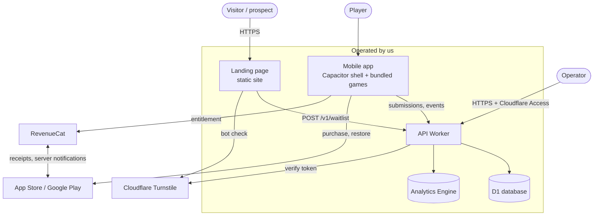
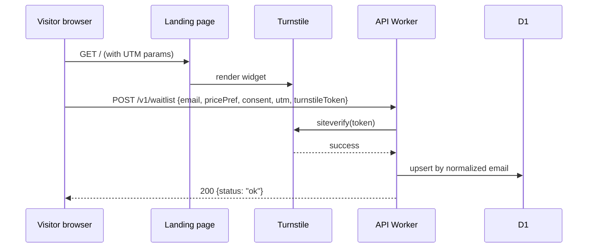

# High-Level Design (HLD)

**Status:** Current, draft-1 (2026-10-04). Nothing described here is implemented yet.
**Owns:** system boundaries, major components and their responsibilities, trust
boundaries, external integrations, deployment topology, and major data flows. How
components collaborate internally is in the [SDD](SDD.md); technology specifics in the
[TDD](TDD.md); contracts in the [LLD](LLD.md).

## 1. System context

## 2. Components

| Component | Responsibility | Not responsible for |
|---|---|---|
| **Landing page** (`apps/landing`) | Explain the product, capture waitlist signups with price preference and attribution (`CAP-1`) | Payments; any third-party tracking |
| **Mobile app shell** (`apps/shell`) | Library, game hosting, settings, paywall, restore, submission form and outbox, analytics client (`CAP-2`…`CAP-11`) | Game rules (delegated to game modules) |
| **Game modules** (`games/*`) | One original game each, implementing `IF-5` | Navigation, purchases, networking |
| **Game SDK** (`packages/game-sdk`) | The contract between shell and games: lifecycle, storage, audio, input | Any network access |
| **API Worker** (`services/api`) | Waitlist, submissions, analytics ingest, admin routes; validation, rate limiting, bot verification | Entitlement decisions (store/RevenueCat own those) |
| **D1** | Waitlist entries, submissions, rate-limit counters | Analytics event volume |
| **Workers Analytics Engine** | Aggregate app analytics events | Anything personal |
| **RevenueCat** (external) | Cross-store purchase validation and entitlement state | Game access logic (the app applies it) |
| **App Store / Google Play** (external) | Distribution, payments, refunds, reviews | — |
| **Cloudflare Turnstile / Access** (external) | Bot checks on the web form; operator authentication | — |

Decisions behind this shape: [ADR-0002](../adr/0002-typescript-games-in-capacitor-shell.md),
[ADR-0004](../adr/0004-cloudflare-workers-d1-backend.md),
[ADR-0005](../adr/0005-store-iap-via-revenuecat.md),
[ADR-0007](../adr/0007-games-bundled-in-binary.md).

## 3. Key architectural properties

- **Offline-first app.** Everything needed to play ships in the binary. The backend is
  on the path only for purchase/restore (via RevenueCat), submission delivery, and
  analytics (`NFR-6`). An API outage degrades those features, never play.
- **No accounts.** Identity is a random install ID for submissions and analytics, and the
  store account for purchases ([ADR-0006](../adr/0006-no-accounts-install-scoped-identity.md)).
- **No third-party ad/tracking code** anywhere ([ADR-0003](../adr/0003-no-ads-no-third-party-tracking.md)).
- **Serverless, managed backend** with no servers to patch (`BC-2`).

## 4. Major data flows

### 4.1 Waitlist signup

### 4.2 Purchase and entitlement

The app calls the RevenueCat SDK, which drives the native store purchase sheet. The store
returns a receipt/transaction to RevenueCat, which validates it and returns customer info
containing the `full_library` entitlement. The app caches it per `RULE-2`/`RULE-4`. Our
API is not involved in the MVP; server-side webhooks are deferred because no server
feature needs entitlement.

### 4.3 Submission

The app writes the submission to its on-device outbox, then `POST /v1/submissions` with
an `Idempotency-Key` equal to the client ID and an `X-Install-Id` header. The Worker
hashes the install ID, checks rate limits, inserts once, and returns the server ID.
Status is read back with `GET /v1/submissions` (same header), returning only that
install's items. Contracts: [LLD §3](LLD.md#3-submissions-api-if-2).

### 4.4 Analytics

The app batches events from the allowed list and posts them to `/v1/events`; the Worker
validates and writes data points to Analytics Engine. Opt-out stops the flow at the
client (`RULE-11`).

## 5. Trust boundaries and threats

| Boundary | Untrusted side | Controls |
|---|---|---|
| Internet → API public routes | All request content | Schema validation (`SEC-5`), Turnstile (web), rate limits (`SEC-4`), body size limit, CORS (`SEC-6`) |
| Internet → `/admin/*` | Anyone but the operator | Cloudflare Access in front plus JWT verification in the Worker (`SEC-3`) |
| App → API | Install IDs are client-chosen and forgeable | Install ID only scopes *reads of non-sensitive status* and rate limits; never grants entitlement or access to others' data |
| App ↔ store/RevenueCat | Local entitlement cache can be tampered with on a rooted device | Accepted risk: content is low-value and offline-first; no server-side content to protect ([ADR-0005](../adr/0005-store-iap-via-revenuecat.md)) |
| Operator → submission text | Submitted text may contain abuse, links, or personal data | Rendered as plain text only; links not auto-followed; operator can decline and delete |

| Threat | Scenario | Mitigation |
|---|---|---|
| Spam/bot signups | Scripted POSTs inflate waitlist numbers and corrupt G1 data | Turnstile, per-IP limits, dedupe; stats exclude entries without passed bot check |
| Submission abuse | Flood of junk or offensive text | Per-install and per-IP limits (`RULE-8`); nothing public; operator moderation |
| Status enumeration | Reading others' submission status | Status reads keyed by install-ID hash; IDs are random UUIDs |
| Admin exposure | Admin routes reachable publicly | Access policy plus in-Worker JWT check (defense in depth) |
| Children's data | Child submits personal info | Not directed at children (`SEC-7`); form warns against personal info; operator deletes on sight |
| Supply chain | A dependency adds tracking | Denylist guard (`SEC-1`), lockfile, release audit |

## 6. Deployment topology

| Environment | Landing | API | Data | App |
|---|---|---|---|---|
| Local | Vite dev server | `wrangler dev` | Local D1 (SQLite) | Browser build, simulators/emulators |
| Preview | Cloudflare Pages preview per PR | Worker `preview` env | `itsthatgame-preview` D1 | TestFlight / Play internal testing builds |
| Production | Cloudflare Pages production | Worker `production` env on the production domain (Q5) | `itsthatgame-prod` D1, Analytics Engine dataset | App Store, Google Play |

All Cloudflare resources live in one account owned by the publishing entity (Q4). Details
in [TDD §7](TDD.md#7-environments-configuration-and-release).
