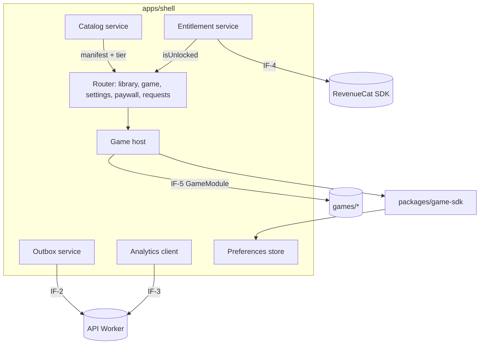

# Software Design Document (SDD)

**Status:** Current, draft-1 (2026-10-04). Nothing described here is implemented yet.
**Owns:** how the subsystems in the [HLD](HLD.md) collaborate, shared design patterns,
interface responsibilities, and the mapping from requirements to design. Technology
choices are in the [TDD](TDD.md); exact contracts and schemas in the [LLD](LLD.md).

## 1. Design principles

1. **Shell owns the platform; games own the fun.** Games never touch navigation,
   purchases, network, or native APIs. They get a narrow SDK facade. This keeps each new
   game cheap to build (`BO-3`) and makes the shell the only place where policy
   (entitlement, analytics, privacy) is enforced.
2. **Data-driven catalog.** What games exist, which are free, and which are new comes
   from one manifest, not code branches.
3. **Local first, sync opportunistically.** Every client action that involves the server
   is written locally first and delivered by an idempotent outbox.
4. **One validation schema per payload,** shared by client and Worker, so both sides
   enforce the same `RULE-*` limits.

## 2. Shell module structure

| Module | Responsibility | Satisfies |
|---|---|---|
| Catalog service | Loads the bundled manifest, validates it at startup, computes "New" | `FR-APP-1`, `FR-APP-5`, `RULE-1`, `RULE-12` |
| Entitlement service | Single source of `isUnlocked(game)` in the app; wraps RevenueCat; owns cache and grace logic | `FR-ENT-*`, `RULE-2`…`RULE-5` |
| Game host | Mounts a game module into a container, drives its lifecycle, isolates failures | `FR-APP-2`, `FR-GAME-1` |
| Preferences store | Namespaced local key-value storage (Capacitor Preferences) | `FR-APP-4`, `FR-APP-6`, `DATA-4` |
| Outbox service | Durable queue with idempotent delivery and backoff | `FR-SUB-2` |
| Analytics client | Allowed-event batching; respects opt-out | `FR-AN-1`, `FR-AN-2` |

## 3. Game runtime

- Each game is an ES module exporting a `GameModule` (`IF-5`, [LLD §1](LLD.md#1-game-sdk-contract-if-5)).
  The host calls `mount(container, ctx)`, then `start()`, and `pause()`/`resume()` on app
  background/foreground (Capacitor `App` state events), and `destroy()` on exit.
- `ctx` gives the game: `storage` (namespaced to its slug, so games cannot read each
  other's data), `audio` (respects sound/music settings), `haptics` (respects setting),
  `viewport` (safe-area aware size), and `exit()`. No `fetch`, no global app state.
- The host wraps every lifecycle call in try/catch and listens for unhandled errors while
  a game is mounted; on error it destroys the game and shows the failure screen (WF-2).
- Games are code-split: the shell imports a game module only when launched, which keeps
  cold start independent of library size (`NFR-1`).
- Rendering engine is the game's choice behind the contract; the default template uses
  Phaser ([TDD §2](TDD.md#2-technology-choices)).
- Accessibility (`NFR-4`): the shell's own UI is semantic HTML with labels and scales
  with system font size; each game completes an accessibility checklist (color-safe
  palettes, no color-only cues, reduced motion) in M3.

## 4. Entitlement

- RevenueCat is configured with one entitlement, `full_library`, attached to every
  product in the current offering (monthly, lifetime, or both). The app checks
  entitlements, never product IDs, so prices and products (Roadmap D1, D2) can change remotely without
  an app release (`BC-6`).
- Gate: `isUnlocked(game) = game.tier == "free" || state in {entitled, entitled_cached}`.
- The entitlement service refreshes on app start and foreground, caches
  `{active, expiresAt|null, checkedAt}`, and runs the client state machine in
  [FRD §4](../requirements/FRD.md#4-state-machines). Grace is computed from a monotonic
  combination of cached expiry and the device clock; clock tampering only extends offline
  access, an accepted risk ([HLD §5](HLD.md#5-trust-boundaries-and-threats)).
- The paywall renders offerings from RevenueCat (store-localized prices) and includes
  restore, terms, and privacy links as required by store rules.

## 5. Submissions and analytics clients

- **Outbox** items: `{clientId (UUIDv4), kind, payload, attempts, nextAttemptAt, state}`
  persisted in Preferences. Delivery runs on app start, foreground, and network-online
  events. Backoff and terminal states: [LLD §8](LLD.md#8-error-handling-retries-and-idempotency).
- **Requests screen** lists outbox items not yet sent plus server status for sent ones,
  fetched with `GET /v1/submissions`.
- **Analytics** batches up to 20 events or 60 seconds, sent through the same transport
  without persistence (losing events is acceptable). Opt-out clears the in-memory
  buffer (`RULE-11`).

## 6. Backend (API Worker)

- One Worker with a small router; one module per route group (`waitlist`, `submissions`,
  `events`, `admin`). Each handler: parse → validate with shared schema → authorize/
  rate-limit → execute → typed JSON response. Error envelope in [LLD §8](LLD.md#8-error-handling-retries-and-idempotency).
- Data access through a thin repository layer over D1 prepared statements; migrations
  in `services/api/migrations` applied with `wrangler d1 migrations apply`.
- Admin routes verify the Cloudflare Access JWT (`Cf-Access-Jwt-Assertion`) against the
  team's public keys and an allowed operator email list in configuration.

## 7. Requirement-to-design map

| Requirement group | Design location |
|---|---|
| `FR-WL-*`, `IF-1` | [HLD §4.1](HLD.md#41-waitlist-signup), §6, [LLD §2](LLD.md#2-waitlist-api-if-1) |
| `FR-APP-*`, `FR-GAME-*`, `IF-5`, `NFR-1`, `NFR-2`, `NFR-4` | §2, §3, [LLD §1](LLD.md#1-game-sdk-contract-if-5), [§4](LLD.md#4-catalog-manifest) |
| `FR-ENT-*`, `IF-4` | §4, [ADR-0005](../adr/0005-store-iap-via-revenuecat.md) |
| `FR-SUB-*`, `IF-2` | §5, §6, [LLD §3](LLD.md#3-submissions-api-if-2), [§6](LLD.md#6-submission-status-state-machine) |
| `FR-AN-*`, `IF-3` | §5, [LLD §3.3](LLD.md#33-analytics-events-if-3) |
| `IF-6`, `SEC-3` | §6, [LLD §7](LLD.md#7-admin-api-if-6) |
| `SEC-*` | [HLD §5](HLD.md#5-trust-boundaries-and-threats), [TDD §6](TDD.md#6-ci-quality-gates-and-security-checks) |
| `DATA-*` | [LLD §5](LLD.md#5-d1-schema), [TDD §7](TDD.md#7-environments-configuration-and-release), [§9](TDD.md#9-observability-capacity-and-cost) |
