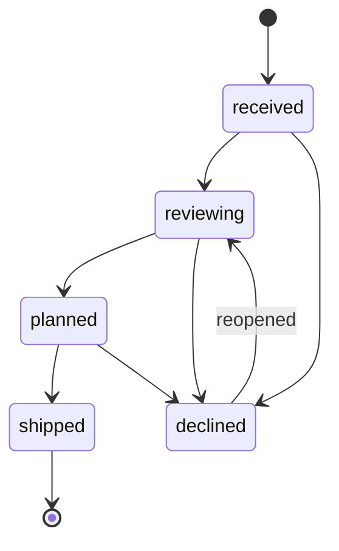
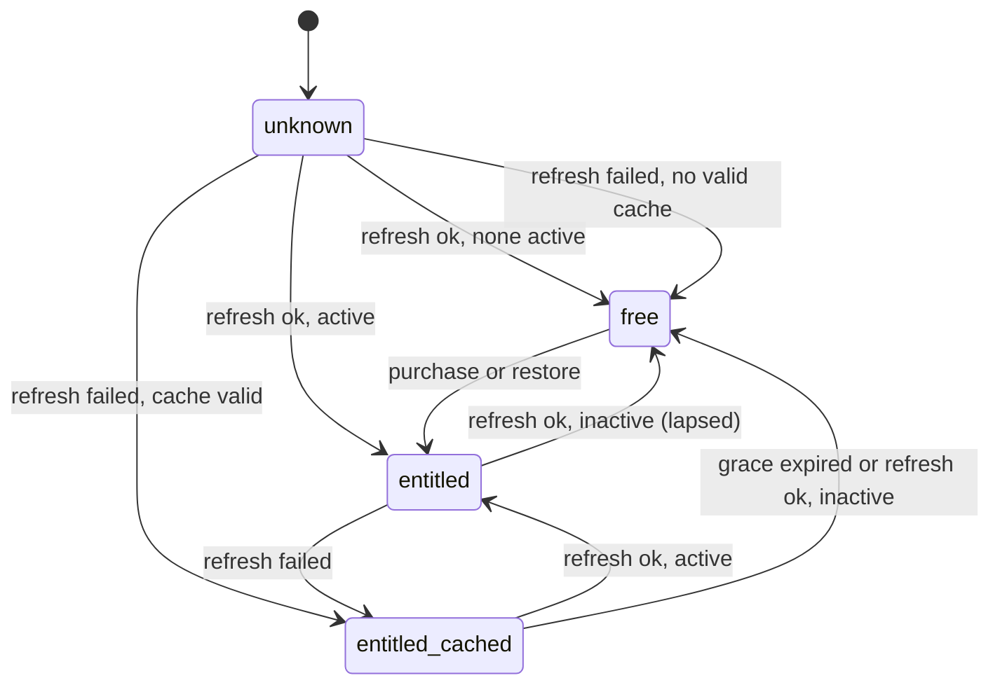

# Functional Requirements Document (FRD)

**Status:** Current, draft-1 (2026-10-04). **Owns:** workflows (`WF-*`), business rules
(`RULE-*`), permissions, and state transitions, with normal, alternate, and failure
paths. The testable statements derived from these live in the [SRS](SRS.md) and are
referenced by ID here, not restated. Interfaces and schemas are in the
[LLD](../design/LLD.md).

## 1. Actors and permissions

| Actor | Identity | Can |
|---|---|---|
| Visitor | None (anonymous web visitor) | Join or leave the waitlist |
| Player | Install ID (random, on device; [ADR-0006](../adr/0006-no-accounts-install-scoped-identity.md)) and store account for purchases | Play free games; buy; restore; submit ideas; see own submissions' status; opt out of analytics |
| Entitled player | Player whose store account has an active entitlement | Everything a player can, plus play premium games |
| Operator | Owner, authenticated by Cloudflare Access (`SEC-3`) | Read waitlist stats/export; list and change submission status |

There are no other roles in the MVP.

## 2. Business rules

| ID | Rule |
|---|---|
| `RULE-1` | A game is free if and only if its catalog entry has `tier: "free"`. Free games are always playable. All other games are premium. |
| `RULE-2` | The store (through RevenueCat) is the source of truth for entitlement. The app caches the last known entitlement state and expiry on device. |
| `RULE-3` | The paywall is shown only when a player taps a locked game or chooses "Unlock all games" in Settings. Never on launch, never mid-game, never on a timer. |
| `RULE-4` | Offline grace: if the device cannot reach RevenueCat, a cached active entitlement is honored until its cached expiry plus a 7-day grace period (Roadmap D9). A lifetime entitlement never expires. |
| `RULE-5` | When an entitlement lapses, premium games relock; all local progress is kept and becomes available again on re-entitlement. |
| `RULE-6` | Waitlist emails are normalized (trimmed, lowercased). One record per normalized email. A repeat signup updates the price preference and `updated_at` but keeps the first-seen source. Consent is required. |
| `RULE-7` | A submission has a description (10–1,000 characters, required), an optional link (http or https, at most 500 characters), and an optional "where I saw it" text (at most 100 characters). The form tells the player not to include personal information. |
| `RULE-8` | Submission rate limits `[Proposal]`: at most 5 accepted submissions per install ID and 20 per IP address per rolling 24 hours. |
| `RULE-9` | A game may be marked releasable in the catalog only after its originality checklist ([TDD §8](../design/TDD.md#8-content-pipeline)) is completed and committed. |
| `RULE-10` | Submission status transitions follow the state machine in [§4](#4-state-machines). Only the operator changes status. |
| `RULE-11` | When a player opts out of analytics, the app stops sending events immediately and discards any unsent events. |
| `RULE-12` | A game shows a "New" badge if it was added in the currently installed app version, until the player first opens it. |

## 3. Workflows

### WF-1 Join the waitlist (`UJ-1`)

1. Visitor lands on the page (UTM parameters, if any, are captured from the URL).
2. Visitor chooses a price preference, enters an email, ticks consent, passes the
   bot check, and submits.
3. System validates and stores per `RULE-6` and shows a confirmation.

- **Alternate:** already signed up → same confirmation (no disclosure of whether the
  email existed); preference updated.
- **Failure:** invalid email or missing consent → inline error, nothing stored. Bot check
  fails → generic error, nothing stored. Rate-limited or server error → "Please try
  again later", nothing stored.
- **Leave:** an unsubscribe link (from any future email) or the privacy page form deletes
  the record (`FR-WL-6`).
- Requirements: `FR-WL-1`…`FR-WL-4`, `FR-WL-6`.

### WF-2 Play a game (`UJ-2`)

1. Player opens the app; the library shows all catalog games, with locked premium games
   visibly marked unless entitled.
2. Player taps a playable game; the shell loads and starts it.
3. Player plays; the game saves progress through the SDK.
4. Player exits to the library, or the app is backgrounded (game pauses) and resumed.

- **Alternate:** locked game tapped → WF-3.
- **Failure:** a game throws during load or play → the shell shows "This game hit a
  problem", returns to the library, and records an `game_error` analytics event if
  analytics is on. Other games are unaffected.
- Requirements: `FR-APP-1`…`FR-APP-4`, `FR-GAME-1`.

### WF-3 Unlock the full library (`UJ-3`)

1. Player taps a locked game or "Unlock all games" (`RULE-3`).
2. The paywall shows the configured products, prices from the store, and terms.
3. Player buys; the store confirms; RevenueCat reports the entitlement active.
4. The app caches the entitlement and unlocks all premium games immediately.

- **Alternate:** player cancels → back to library, nothing changes.
- **Failure:** store or network error → message, no state change; pending purchases
  (e.g. parental approval, "Ask to Buy") show "Purchase pending" and unlock when
  confirmed later.
- Requirements: `FR-ENT-2`, `FR-ENT-3`.

### WF-4 Restore and offline entitlement (`UJ-4`)

1. Player taps "Restore purchases" in Settings or on the paywall.
2. The app asks RevenueCat to restore; active entitlements for that store account are
   applied.

- **Alternate:** nothing to restore → "No purchases found for this store account".
- **Offline:** cached entitlement applies per `RULE-4`; on next successful refresh the
  cache is updated; lapsed entitlement handled per `RULE-5`.
- Requirements: `FR-ENT-4`, `FR-ENT-5`, `FR-ENT-6`.

### WF-5 Submit an idea (`UJ-5`)

1. Player opens "Request a game", fills the form (`RULE-7`), and submits.
2. The app stores the submission locally with a client-generated ID and sends it.
3. The server validates, applies `RULE-8`, stores it as `received`, and returns the ID.
4. The player's "My requests" list shows each submission and its latest status.

- **Alternate:** offline → stored locally as "Waiting to send" and sent automatically
  when online; retries use the same client ID so the server stores it once.
- **Failure:** validation error → inline message; rate-limited → "You've sent a lot of
  requests today, try tomorrow"; permanent rejection removes it from the outbox with a
  visible message.
- Requirements: `FR-SUB-1`, `FR-SUB-2`, `FR-SUB-3`, `FR-SUB-6`.

### WF-6 Triage submissions (`UJ-6`)

1. Operator lists submissions with status `received`, newest first.
2. Operator sets each to `reviewing`, `planned`, `declined`, or (later) `shipped`, with an
   optional public note (shown to the submitter, at most 280 characters).

- **Failure:** invalid transition → rejected with the allowed transitions listed.
- Requirements: `FR-SUB-4`, `FR-SUB-5`.

### WF-7 Receive new games (`UJ-7`)

New games ship in app updates ([ADR-0007](../adr/0007-games-bundled-in-binary.md)). After
updating, games added in that version show "New" (`RULE-12`). Requirement: `FR-APP-5`.

## 4. State machines

Submission status (`RULE-10`):

Client entitlement state (`RULE-2`, `RULE-4`, `RULE-5`):

Submission outbox on device: `queued → sending → sent`, with `sending → queued` on
network or 5xx error (exponential backoff) and `sending → failed` on 4xx other than 429.
